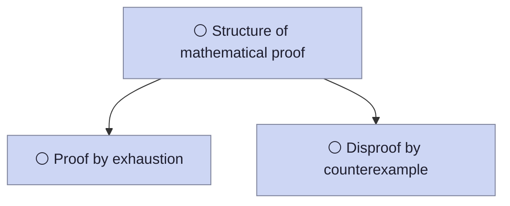

> **Unpublished automated review transcript; contains answers.** This simulated scratch lesson covers 36 forms. Written answers use placeholder work and simulated full marks to advance; feedback is not a real assessment. The isolated candidate includes proposed i15 and faded-check corrections, which have not passed the preservation gate. The experimental AI tutor is incomplete. This capture excludes on-demand detail and alternate paths.

# Lesson - Proof
_Tuesday 29 September 2026, 17:00_

> [!abstract] What do you want from Proof?
> - Learn it properly from scratch
> - I've had lessons: find and fill my gaps
> - Revise for a test soon
> - Just the key ideas, quickly

> [!quote] You
> Learn it properly from scratch

> [!abstract] Plan: Proof
> We'll build **3 ideas** in the order of the map: each one is motivated, established, connected to what you already have, then checked without hints. We start from Structure of mathematical proof.
>
> - Structure of mathematical proof
> - Proof by exhaustion
> - Disproof by counterexample

> [!quote] You
> Plan approved: Structure of mathematical proof, Proof by exhaustion, Disproof by counterexample

> [!abstract] Why this matters
> A convincing pattern is not yet a proof. In an exam, a marker must be able to follow why the result holds for every value covered by the question.

> [!question] Q1 · MCQ · 1 mark
> In a proof about every integer $n$, $k$ is an integer. Which expression can represent every integer $n$?
>
> **A.** $n=2k$
> **B.** $n=2k+1$
> **C.** $n=k+211$
> **D.** $n=k^2$

> [!success] Q1 — Correct ✓
> **Your answer:** C (confidence 3)
> **Answer:** C: $n=k+211$
>
> For every integer $n$, choose $k=n-211$, which is an integer. The form $2k$ misses odd integers; $2k+1$ misses even integers; $k^2$ misses negative integers.

> [!abstract] Helpful terms
> - **Proof** — A logical argument that establishes a claim from its assumptions. Read: proof.
> - **Assumption** — A given fact or condition used as the starting point. Read: assumption.
> - **Domain** — The allowed values to which a claim applies. Read: domain.
> - **Integer** — A whole number, including zero and negative whole numbers. Notation: ℤ. Read: the integers.
> - **LHS and RHS** — The left-hand and right-hand sides of a statement. Notation: LHS, RHS. Read: left-hand side; right-hand side.
> - **Product** — The result of multiplication, not addition. For example, the product of 2 and 3 is 6. Notation: $ab$ or $a\times b$. Read: a times b.
> - **Factor theorem** — For a polynomial f, x − r is a factor exactly when f(r) equals zero. Notation: $f(r)=0$. Read: f of r equals zero.

> [!abstract] In plain words
> A proof explains why a claim follows from its assumptions. A few successful examples can suggest a pattern, but they do not establish a claim about every integer.

> [!abstract] Exam language
> - **Prove:** Give a complete logical argument that covers the stated domain.
> - **Show that:** Establish the supplied result with sufficient working; the result itself is not the proof.
> - **Hence:** Use the preceding result as directed. Check the exact question wording.
> - **Hence or otherwise:** The preceding result may help, but a different valid method can earn marks.
> - **Verify:** Check that the given values satisfy the stated conditions; one verification does not prove a universal claim.
> - **M marks:** Method marks reward an appropriate method or substantial step, as defined by the question-specific scheme.
> - **A marks:** Accuracy marks reward a correct result or step; they can depend on the associated method mark.
> - **B marks:** Independent marks reward a correct result or statement without depending on a method mark. Specific award and follow-through rules come from the mark scheme.

> [!abstract] Diagram
> Begin with the assumptions and allowed domain. Follow justified logical steps to the required conclusion.
>
> ![[Assets/P2/P2-1-proof-flow.svg]]

> [!abstract] Worked example
> Show that $n(n+1)$ is even for every integer $n$.

> [!abstract] Step 1
> Let $n$ be an arbitrary integer. Every integer is either even or odd.
>
> _The domain includes positive integers, zero and negative integers; these two cases cover it completely._

> [!abstract] Step 2
> If $n=2k$, where $k$ is an integer, then $n(n+1)=2k(2k+1)=2[k(2k+1)]$.
>
> _The bracket is an integer, so this is twice an integer and therefore even._

> [!abstract] Step 3
> If $n=2k+1$, where $k$ is an integer, then $n(n+1)=(2k+1)(2k+2)=2[(2k+1)(k+1)]$.
>
> _Again the bracket is an integer, so the product is even._

> [!abstract] Step 4
> Therefore $n(n+1)$ is even for every integer $n$.
>
> _Both possible parity cases have been proved generally. Checking sample values alone leaves infinitely many integers untested._

> [!abstract] Common misconception
> **The idea:** Several examples prove a universal claim.
>
> **Why it is tempting:** All checked examples fit the pattern.
>
> **The fix:** Give a general argument or a complete set of cases.

> [!abstract] Common misconception
> **The idea:** Every integer can be written as $2k$.
>
> **Why it is tempting:** $2k$ is a familiar integer representation.
>
> **The fix:** $2k$ represents even integers only; an arbitrary integer may be odd.

> [!abstract] General algebraic argument
> **Wording:** Prove that, Show that
>
> **Claim:** The sum of two even integers is even.
>
> - Let the integers be $2a$ and $2b$, where $a$ and $b$ are integers.
> - Their sum is $2(a+b)$.
> - Since $a+b$ is an integer, the sum is even.
>
> Two even integers can be written as $2m$ and $2n$, where $m$ and $n$ are integers. They may be equal, but need not be. Writing both as $2n$ without justification covers only equal inputs. Their product is $4mn$, a multiple of $4$.

> [!question] Q2 · SHORT · 2 marks · no hints
> Prove that the sum of two odd integers is even.

> [!success] Q2 — Correct ✓
> **Your answer:** A practice response (confidence 3)
> **Answer:** Applies a general property to both odd integers, such as independently writing 2a+1 and 2b+1, or giving both remainder 1 modulo 2. The integers may be equal.; Shows the sum is even for arbitrary odd integers, using algebra or remainders; equal inputs alone are insufficient.

> [!abstract] Identify invalid working
> **Wording:** Explain why the argument is invalid, What is wrong with this proof?
>
> A student starts a proof with $n=2k$ for an arbitrary integer $n$.
>
> - This representation assumes that $n$ is even.
> - Odd integers are also allowed, so the argument does not cover the whole domain.

> [!question] Q3 · SHORT · 1 mark · no hints
> A student solves $n^2=n$ for real $n$ by dividing both sides by $n$ and concludes that the only solution is $n=1$. Explain the gap.

> [!success] Q3 — Correct ✓
> **Your answer:** A practice response (confidence 3)
> **Answer:** Identifies that division by n excludes n = 0, which also satisfies the original equation.

> [!abstract] Justify division in an inequality proof
> **Wording:** Prove that, Explain why the inequality follows
>
> **Claim:** If $t>0$ and $tx>ty$, then $x>y$.
>
> - The assumption $t>0$ means $t$ is positive and non-zero.
> - Divide both sides by $t$; division by a positive number preserves the inequality.
> - Therefore $x>y$.

> [!question] Q4 · SHORT · 2 marks · no hints
> Suppose $c<0$ and $cx<cy$. Explain why $x>y$.

> [!success] Q4 — Correct ✓
> **Your answer:** A practice response (confidence 3)
> **Answer:** Identifies c as negative (which also implies it is non-zero).; Divides by c, or multiplies by its negative reciprocal, reverses the inequality and concludes $x>y$.

> [!abstract] Geometric proof using earlier results
> **Wording:** Prove that the circles do not meet, Using your earlier results, show that the circles are separate
>
> **Given:** Two circles have radii $3$ and $4$ units. Their centres are $10$ units apart. If the distance between centres is greater than the sum of their radii, the circles cannot touch or intersect.
>
> - The sum of the radii is $3+4=7$.
> - The centre distance is $10$, and $10>7$.
> - The given criterion applies, so the circles neither touch nor intersect.

> [!question] Q5 · SHORT · 2 marks · no hints
> Two circles have radii $2$ and $4$ units, and their centres are $9$ units apart. If the distance between centres is greater than the sum of their radii, the circles cannot touch or intersect. Use this fact to explain why these circles cannot touch or intersect.

> [!success] Q5 — Correct ✓
> **Your answer:** A practice response (confidence 3)
> **Answer:** Calculates the sum of the radii as 6 units.; States that the centre distance 9 exceeds 6, then uses the given criterion to conclude that the circles neither touch nor intersect. A conclusion without that comparison is insufficient.

> [!abstract] Derive a formula from a series
> **Wording:** Prove the formula for the sum, Show that the sum to n terms is the given expression, Hence show a related sum using the preceding result
>
> **Claim:** For an integer $n\geq3$, $1+2+\cdots+n=\frac{n(n+1)}{2}$.
>
> - Let $S=1+2+\cdots+n$. Reverse the same sum: $S=n+(n-1)+\cdots+1$.
> - Add corresponding terms. Each pair is $n+1$, and there are $n$ pairs, so $2S=n(n+1)$.
> - Divide by $2$ to obtain the stated formula.
> - For $n=1$ and $n=2$, the sums are $1$ and $3$ respectively, matching the formula.
>
> **General arithmetic series:** Let $n\geq3$ be an integer, with first term $a$ and common difference $d$. The last term is $a+(n-1)d$, not $a+nd$.
>
> - Write $S=a+(a+d)+\cdots+[a+(n-1)d]$.
> - Write the same sum in reverse: $S=[a+(n-1)d]+[a+(n-2)d]+\cdots+a$.
> - Add matching columns. There are $n$ pairs, each equal to $2a+(n-1)d$, so $2S=n[2a+(n-1)d]$.
> - Divide by $2$: $S=\frac{n}{2}[2a+(n-1)d]$. The two-row method works for odd and even $n$; no unpaired middle term is lost.
> - For $n=1$ and $n=2$, direct addition also gives the formula. The formula is derived from the terms, not assumed at the start.
>
> **Using a previous result:** Given $1+2+\cdots+n=\frac{n(n+1)}{2}$, hence show that $3+6+\cdots+3n=\frac{3n(n+1)}{2}$.
>
> - Each term is three times its counterpart in the given sum.
> - Multiply the given result by $3$ to obtain the required sum. Here “hence” directs you to use that result.

> [!question] Q6 · SHORT · 2 marks · no hints
> Given that $1+2+\cdots+n=\frac{n(n+1)}{2}$ for positive integer $n$. Hence prove that the sum of the first $n$ positive odd integers is $n^2$.

> [!success] Q6 — Correct ✓
> **Your answer:** A practice response (confidence 3)
> **Answer:** Writes the odd-number sum as twice the given sum minus n.; Uses the given formula and derives n squared.

> [!abstract] Geometric-series proof by cancellation
> **Wording:** Prove the sum of a geometric series, Show the formula and state any restriction
>
> **Claim:** For an integer $n\geq3$, the sum $S=1+2+\cdots+2^{n-1}$ equals $2^n-1$.
>
> - Multiply each term by $2$: $2S=2+2^2+\cdots+2^n$.
> - Subtract $S$ from $2S$. The intermediate powers cancel, giving $2S-S=2^n-1$.
> - Therefore $S=2^n-1$.
> - For $n=1$ and $n=2$, the sums are $1$ and $3$, matching the formula.
>
> When subtracting, keep the order consistent: $2S-S$ leaves $2^n-1$, not $1-2^n$. Show that uncancelled line before simplifying. In a general derivation, division by $1-r$ is allowed only when $r\ne1$. If $r=1$, all $n$ terms equal the first term $a$, so the sum is $na$; handle that case separately.

> [!question] Q7 · SHORT · 3 marks · no hints
> For real $a$ and $r$ with $r\ne1$, and integer $n\geq3$, prove that $a+ar+\cdots+ar^{n-1}=\frac{a(1-r^n)}{1-r}$. Show the unfactorised line after subtracting.

> [!success] Q7 — Correct ✓
> **Your answer:** A practice response (confidence 3)
> **Answer:** Writes the sum and its multiple by r, aligned so that intermediate terms cancel.; Subtracts in a consistent order and shows S − rS = a − ar^n, or its equivalent.; Factorises and divides by the nonzero 1 − r to obtain the stated formula; accepts equivalent signs.

> [!abstract] Prove a stationary point is a maximum
> **Wording:** Use further calculus to prove that the stationary point is a maximum, Justify the nature of the stationary point
>
> **Given:** A twice-differentiable function $f$ has a stationary point at $x=1$ and $f\prime\prime(x)=-2$. At a stationary point, a negative second derivative establishes a local maximum.
>
> - At $x=1$, $f\prime\prime(1)=-2<0$.
> - The stated second-derivative criterion applies, so the stationary point is a local maximum.
> - The sign establishes the local nature of the point; it does not alone prove a global maximum on an arbitrary domain.

> [!question] Q8 · SHORT · 2 marks · no hints
> A twice-differentiable function $g$ has a stationary point at $x=2$ and $g\prime\prime(x)=-2x-2$. At a stationary point, a negative second derivative establishes a local maximum. Prove that this stationary point is a local maximum.

> [!success] Q8 — Correct ✓
> **Your answer:** A practice response (confidence 3)
> **Answer:** Substitutes x = 2 into the second derivative and obtains −6.; Uses the negative second derivative at the stationary point to conclude it is a local maximum.

> [!abstract] Geometric proof with alternative chains of reasoning
> **Wording:** Prove that a chord is a diameter, Use geometry to justify the conclusion
>
> **Given:** Distinct points $A=(0,0)$, $B=(6,0)$ and $C=(3,3)$ lie on a circle. A chord joining two points on a circle is a diameter if the angle at a third point on the circle is a right angle.
>
> - **Using lengths:** $AC^2=18$, $BC^2=18$ and $AB^2=36$. The converse of Pythagoras gives a right angle at $C$.
> - **Alternatively, using gradients:** $AC$ has gradient $1$ and $BC$ has gradient $-1$. Their product is $-1$, so the lines are perpendicular.
> - Either complete route establishes a right angle at $C$. The given circle fact then shows that $AB$ is a diameter.
> - **Alternatively, using the midpoint:** $M=(3,0)$ is the midpoint of $AB$, and $MA=MB=MC=3$. The three non-collinear points have a unique circle, so $M$ is its centre; therefore $AB$ is a diameter.
>
> ![[Assets/P2/P2-1-geometry.svg]]

> [!question] Q9 · SHORT · 2 marks · no hints
> Distinct points $A=(0,0)$, $B=(10,0)$ and $C=(8,4)$ lie on a circle. A chord joining two points on a circle is a diameter if the angle at a third point on the circle is a right angle. Prove that $AB$ is a diameter, using gradients, squared lengths, or the midpoint.

> [!success] Q9 — Correct ✓
> **Your answer:** A practice response (confidence 3)
> **Answer:** Calculates the relevant squared lengths or gradients, or finds midpoint (5, 0) and the three equal distances.; Justifies the right angle and applies the circle fact, or justifies that the midpoint is the circle centre, and concludes AB is a diameter.

> [!abstract] Show a trigonometric identity
> **Wording:** Show that the identity holds, Prove the identity on the stated domain
>
> **Given:** $\sin^2\theta+\cos^2\theta=1$. Show that $\frac{1-\cos^2\theta}{\sin\theta}=\sin\theta$ where $\sin\theta\ne 0$.
>
> - Work from the left-hand side. The given identity gives $1-\cos^2\theta=\sin^2\theta$.
> - Since $\sin\theta\ne 0$, division gives $\frac{\sin^2\theta}{\sin\theta}=\sin\theta$.
> - This is the right-hand side, so the identity holds on the stated domain.

> [!question] Q10 · SHORT · 2 marks · no hints
> Given $\sin^2\theta+\cos^2\theta=1$, show that $\frac{1-\sin^2\theta}{\cos\theta}=\cos\theta$ where $\cos\theta\ne 0$.

> [!success] Q10 — Correct ✓
> **Your answer:** A practice response (confidence 3)
> **Answer:** Uses the given identity to rewrite the numerator as cos²θ.; Divides by cosθ using the stated domain and concludes that the left-hand side equals the right-hand side; the nonzero condition need not be repeated.

> [!abstract] Prove an inequality using a non-negative square
> **Wording:** Use algebra to prove the inequality, Prove the inequality for all real values
>
> **Claim:** For every real $x$, $x^2+1\geq2x$.
>
> - The square $(x-1)^2$ is non-negative.
> - Expand: $x^2-2x+1\geq0$.
> - Add $2x$ to both sides. Thus $x^2+1\geq2x$ for every real $x$.

> [!question] Q11 · SHORT · 2 marks · no hints
> Prove that $x^2+4\geq4x$ for every real $x$.

> [!success] Q11 — Correct ✓
> **Your answer:** A practice response (confidence 3)
> **Answer:** Establishes a non-negative expression equivalent to the difference between the sides, or uses another valid general argument.; Rearranges with justified steps and concludes the stated inequality on the real domain.

> [!abstract] Prove an inequality involving a square root
> **Wording:** Use algebra to prove an inequality on a restricted domain, Show that the inequality holds when the square root is defined
>
> **Claim:** For every real $x\geq0$, $x+1\geq2\sqrt{x}$.
>
> - The stated domain makes $\sqrt{x}$ real, so $(\sqrt{x}-1)^2\geq0$.
> - Expand: $x-2\sqrt{x}+1\geq0$.
> - Add $2\sqrt{x}$ to both sides. Thus the claim holds on the stated domain.

> [!question] Q12 · SHORT · 2 marks · no hints
> Prove that $x+4\geq4\sqrt{x}$ for every real $x\geq0$.

> [!success] Q12 — Correct ✓
> **Your answer:** A practice response (confidence 3)
> **Answer:** Uses a valid general argument on the stated domain, such as the non-negative square (√x − 2)².; Obtains the required inequality with valid steps and states the conclusion; accepts other complete proofs.

> [!abstract] Show a parameter using the factor theorem
> **Wording:** Show that the constant has the given value, Use the factor theorem to establish the stated parameter
>
> **Given:** $f(x)=x^2+kx+2$ and $x-1$ is a factor. Show that $k=-3$. You may use the factor theorem: if $x-r$ is a factor of $f(x)$, then $f(r)=0$.
>
> - The factor $x-1$ gives $f(1)=0$.
> - Substitute: $1+k+2=0$.
> - Solve to obtain $k=-3$, as required.
>
> Exam note: A mark scheme may credit checking a supplied value, but that check alone establishes compatibility, not that the condition forces the value. Deriving the value from the given factor also establishes necessity.

> [!question] Q13 · SHORT · 2 marks · no hints
> Let $g(x)=x^2+ax-6$. Given that $x-2$ is a factor and using the factor theorem, show that $a=1$.

> [!success] Q13 — Correct ✓
> **Your answer:** A practice response (confidence 3)
> **Answer:** Uses the given factor to infer g(2) = 0 for the unknown parameter.; Shows correct intermediate arithmetic and derives a = 1.

> [!abstract] Prove there are no turning points
> **Wording:** Prove the curve has no turning points, Show that the gradient never becomes zero
>
> **Claim:** $y=x^3+x$ has no turning points. The derivative gives the gradient.
>
> - $dy/dx=3x^2+1$.
> - Since $x^2\geq0$ for every real $x$, $3x^2+1>0$.
> - The gradient is never zero. The differentiable curve has no turning points.

> [!question] Q14 · SHORT · 2 marks · no hints
> Prove that $y=x^3+3x$ has no turning points.

> [!success] Q14 — Correct ✓
> **Your answer:** A practice response (confidence 3)
> **Answer:** Differentiates correctly to obtain 3x² + 3.; Justifies that the derivative is positive for all real x and concludes there are no turning points.

> [!abstract] Show a relation from an arithmetic sequence
> **Wording:** Show the stated relation using consecutive arithmetic-sequence terms, Use equal differences to derive the given equation
>
> **Given:** $t$, $2t+1$, $5t-2$ are consecutive terms of an arithmetic sequence. Show that $2t=4$.
>
> - Consecutive differences are equal: $(2t+1)-t=(5t-2)-(2t+1)$.
> - Simplify to $t+1=3t-3$.
> - Rearrange to obtain $2t=4$, as required.

> [!question] Q15 · SHORT · 2 marks · no hints
> The terms $p$, $3p-1$, $4p+2$ are consecutive terms of an arithmetic sequence. Show that $p=4$.

> [!success] Q15 — Correct ✓
> **Your answer:** A practice response (confidence 3)
> **Answer:** Equates the consecutive differences: 2p − 1 = p + 3.; Rearranges correctly and concludes p = 4.

> [!abstract] Derive a trigonometric relation from a sequence
> **Wording:** Show the stated trigonometric relation from consecutive arithmetic-sequence terms, Use equal differences to establish the relation
>
> **Given:** $\sin\theta$, $\cos\theta$ and $2\sin\theta$ are consecutive terms of an arithmetic sequence. Show that $2\cos\theta=3\sin\theta$.
>
> - Equal consecutive differences give $\cos\theta-\sin\theta=2\sin\theta-\cos\theta$.
> - Add $\cos\theta$ and $\sin\theta$ to both sides. This gives $2\cos\theta=3\sin\theta$, as required.
> - This relation follows from the sequence condition; it is not an identity for every angle.

> [!question] Q16 · SHORT · 2 marks · no hints
> The terms $\sin\alpha$, $\cos\alpha$ and $3\sin\alpha$ are consecutive terms of an arithmetic sequence. Show that $2\cos\alpha=4\sin\alpha$.

> [!success] Q16 — Correct ✓
> **Your answer:** A practice response (confidence 3)
> **Answer:** Sets the consecutive differences equal: cos α − sin α = 3 sin α − cos α.; Rearranges correctly to obtain 2 cos α = 4 sin α and states the conclusion.

> [!abstract] Derive a relation using reciprocal tangent
> **Wording:** Use consecutive arithmetic-sequence terms to show a trigonometric relation, Rewrite reciprocal tangent and establish the stated equation
>
> **Given:** $\sin\theta$, $1/\tan\theta$ and $3\sin\theta$ are consecutive terms of an arithmetic sequence, where $\sin\theta\ne0$ and $\cos\theta\ne0$. Show that $2\cos\theta=4\sin^2\theta$.
>
> - Equal differences give $1/\tan\theta-\sin\theta=3\sin\theta-1/\tan\theta$.
> - Rearrange: $2/\tan\theta=4\sin\theta$.
> - Because both sine and cosine are nonzero, $1/\tan\theta=\cos\theta/\sin\theta$. Multiply by $\sin\theta$ to obtain $2\cos\theta=4\sin^2\theta$.
> - The conclusion follows for angles satisfying the stated conditions and sequence condition; it is not an identity for every angle.

> [!question] Q17 · SHORT · 2 marks · no hints
> The terms $2\sin\alpha$, $1/\tan\alpha$ and $4\sin\alpha$ are consecutive terms of an arithmetic sequence. Given $\sin\alpha\ne0$ and $\cos\alpha\ne0$, show that $2\cos\alpha=6\sin^2\alpha$.

> [!success] Q17 — Correct ✓
> **Your answer:** A practice response (confidence 3)
> **Answer:** Equates consecutive differences and obtains 2/tan α = 6 sin α.; Rewrites reciprocal tangent as cos α / sin α and obtains 2 cos α = 6 sin² α with valid steps.

> [!abstract] Show an approximation from binomial expansions
> **Wording:** Show an approximation, Use expansions to find constants
>
> **Given:** Ignore terms of degree $4$ and above. Show that $(1+x)^4+(1-x)^4$ is approximately $2+12x^2$.
>
> - Expand to cubic terms: $1+4x+6x^2+4x^3$ and $1-4x+6x^2-4x^3$.
> - Adding cancels odd powers and gives $2+12x^2$. The discarded $2x^4$ explains why this is an approximation.

> [!question] Q18 · SHORT · 2 marks · no hints
> Ignoring terms of degree $4$ and above, show that $(1+x)^5+(1-x)^5$ is approximately $2+20x^2$. Show the relevant expansions.

> [!success] Q18 — Correct ✓
> **Your answer:** A practice response (confidence 3)
> **Answer:** Expands both expressions consistently through cubic terms, with opposite odd-power signs.; Adds the expansions correctly and gives the stated approximation; cancellation may be shown by the sum without an explicit statement.

> [!abstract] Transform a trigonometric equation
> **Wording:** Show that an equation can be written as, Use trigonometric identities
>
> **Given:** $\cos\theta\ne0$ and $\sin\theta\tan\theta=1-\cos\theta$. Show that $\cos\theta=1$.
>
> - Replace tangent by $\sin\theta/\cos\theta$ and multiply by the nonzero cosine.
> - This gives $\sin^2\theta=\cos\theta-\cos^2\theta$.
> - Substitute $\sin^2\theta=1-\cos^2\theta$ and simplify to $\cos\theta=1$. The original domain is retained.

> [!question] Q19 · SHORT · 2 marks · no hints
> Given $\cos\theta\ne0$ and $\cos\theta+1=2\sin\theta\tan\theta$, show that $3\cos^2\theta+\cos\theta-2=0$. Show both identities used.

> [!success] Q19 — Correct ✓
> **Your answer:** A practice response (confidence 3)
> **Answer:** Uses the tangent identity and multiplies by the given nonzero cosine.; Uses the Pythagorean identity and shows a correct rearrangement.

> [!abstract] Show a stated definite integral
> **Wording:** Show that the integral has the stated value, Evaluate and justify
>
> **Show:** $\int_0^2 (x-1)\,dx=0$.
>
> - An antiderivative is $F(x)=x^2/2-x$.
> - Substitute both limits: $F(2)-F(0)=(2-2)-0=0$.
> - Brackets make the subtraction at the lower limit clear.

> [!question] Q20 · SHORT · 2 marks · no hints
> Show that $\int_1^3 (2x-4)\,dx=0$, writing the antiderivative and both substituted values.

> [!success] Q20 — Correct ✓
> **Your answer:** A practice response (confidence 3)
> **Answer:** Finds a correct antiderivative.; Substitutes both limits, subtracts correctly and establishes the given value.

> [!abstract] Show a quadratic from a contextual arithmetic series
> **Wording:** Show that the number of rows satisfies the given quadratic, Hence find the number of rows
>
> **Example:** The first row has 5 seats, each next row has 3 more, and there are 185 seats in total. Show that $3n^2+7n-370=0$, where $n$ is the number of rows. Hence find $n$.
>
> - Use $S_n=\frac{n}{2}[2a+(n-1)d]$ with $a=5$ and $d=3$.
> - $185=\frac{n}{2}[10+3(n-1)]=\frac{n}{2}(3n+7)$.
> - Multiply by 2 and rearrange to obtain $3n^2+7n-370=0$.
> - Factor as $(n-10)(3n+37)=0$. A row count must be positive, so $n=10$.

> [!question] Q21 · SHORT · 3 marks · no hints
> A hall has 4 seats in its first row and 2 more seats in each subsequent row. There are 154 seats altogether. Show that $n^2+3n-154=0$, where $n$ is the number of rows. Hence find $n$.

> [!success] Q21 — Correct ✓
> **Your answer:** A practice response (confidence 3)
> **Answer:** Uses a correct arithmetic-series sum with first term 4, common difference 2 and total 154.; Shows a correct intermediate equation and rearranges to the stated quadratic.; Finds n=11 and selects the positive value for the number of rows.

> [!abstract] Show a radius-line equation from a tangent
> **Wording:** Show the equation of the radius line through the point of tangency, Use perpendicular gradients to show the given line equation
>
> **Example:** A circle has centre $(1,2)$, and its tangent at $P$ has gradient $\frac{3}{2}$. Show that the line through the centre and $P$ is $2x+3y-8=0$.
>
> - A radius to the point of tangency is perpendicular to the tangent, so its gradient is $-\frac{2}{3}$.
> - Through $(1,2)$, $y-2=-\frac{2}{3}(x-1)$.
> - Multiply by 3 and rearrange: $3y-6=-2x+2$, so $2x+3y-8=0$.

> [!question] Q22 · SHORT · 3 marks · no hints
> A circle has centre $(2,1)$, and its tangent at $P$ has gradient $\frac{4}{3}$. Show that the radius line through the centre and $P$ is $3x+4y-10=0$, giving a reason for its gradient.

> [!success] Q22 — Correct ✓
> **Your answer:** A practice response (confidence 3)
> **Answer:** Uses perpendicularity to find the radius gradient -3/4.; Uses the centre (2,1) in a correct line equation.; Shows valid intermediate algebra and obtains the stated line equation.

> [!abstract] Show surface area from a volume constraint
> **Wording:** Use the volume constraint to show an area formula, Derive the open-box area in terms of x
>
> **Example:** An open box has a square base of side $x$ m, height $h$ m and volume $8\,\mathrm{m}^3$, where $x>0$. Use volume = base area × height, and add the base and four side faces. Show that $S=x^2+32/x$ m². There is no lid.
>
> - The volume gives $x^2h=8$, so $h=8/x^2$.
> - The base and four walls give $S=x^2+4xh$.
> - Substitution gives $S=x^2+32/x$.
>
> ![[Assets/P2/P2-1-open-box-net.svg]]

> [!question] Q23 · SHORT · 3 marks · no hints
> An open box has base $x$ by $3x$ m and volume $6\,\mathrm{m}^3$, where $x>0$. Use volume = base area × height and add the base and four side faces. Show that its surface area is $3x^2+16/x$ m².

> [!success] Q23 — Correct ✓
> **Your answer:** A practice response (confidence 3)
> **Answer:** Uses the volume relation to find or substitute the height.; Includes the base and all four side faces with correct areas.; Substitutes correctly and derives the stated area for positive x.

> [!abstract] Show an exponential intersection using index laws
> **Wording:** Show the exact intersection using logarithms, Equate exponential functions and justify each algebraic step
>
> **Example:** Show that $y=8^{1-x}$ and $y=2\cdot4^x$ meet at $x=\log(4)/\log(32)$. At an intersection the $y$ values agree. For positive bases, $a^{u+v}=a^ua^v$ and $\log(a^u)=u\log(a)$.
>
> - Equate: $8/8^x=2\cdot4^x$.
> - Multiply by $8^x$ and divide by 2: $4=32^x$.
> - Taking logarithms gives $x=\log(4)/\log(32)=2/5$.

> [!question] Q24 · SHORT · 3 marks · no hints
> Show that $y=9^{1-x}$ and $y=3\cdot3^x$ meet at $x=1/3$. At an intersection the y values agree; for positive bases $a^{u+v}=a^ua^v$.

> [!success] Q24 — Correct ✓
> **Your answer:** A practice response (confidence 3)
> **Answer:** Equates the two functions and applies index laws correctly.; Solves the resulting exponential equation by logarithms or a valid common-base argument.; Shows valid intermediate working and the stated exact result.

> [!abstract] Prove no turning points using a quadratic gradient
> **Wording:** Prove a curve has no turning points using a negative discriminant, Show a quadratic gradient is positive for every real input
>
> **Useful facts:** For real $x$, $(x-h)^2\geq0$. A quadratic $ax^2+bx+c$ with $b^2-4ac<0$ has no real roots. A differentiable curve on the real line can turn only at a point where its derivative is zero. The converse is not guaranteed: a zero derivative need not be a turning point.
>
> **Example:** A differentiable curve has gradient $3x^2-6x+5$. Prove it has no turning points.
>
> - Completing the square gives $3(x-1)^2+2>0$ for every real $x$, so the gradient is never zero.
> - Alternatively, the gradient equation has discriminant $(-6)^2-4(3)(5)=-24<0$, so it has no real solution.
> - In either route the gradient is never zero. The curve therefore has no turning points.

> [!question] Q25 · SHORT · 2 marks · no hints
> The differentiable curve $y=x^3-3x^2+4x$ has derivative $3x^2-6x+4$. Prove it has no turning points for real $x$. You may use the facts stated in the example.

> [!success] Q25 — Correct ✓
> **Your answer:** A practice response (confidence 3)
> **Answer:** Establishes a valid global method: the derivative has no real zero, or the curve is strictly monotonic on the real line.; Justifies the method and concludes that the curve has no turning points.

> [!question] Q26 · MCQ · 1 mark · no hints
> A proposed proof begins, 'Let $n$ be any positive integer. Since $n=2k$, $n^2$ is divisible by 4.' Identify the flaw.
>
> **A.** Not every positive integer has the form $2k$.
> **B.** A proof may not begin with an arbitrary integer.
> **C.** Squaring $2k$ does not give $4k^2$.
> **D.** A multiple of 4 is never even.

> [!success] Q26 — Correct ✓
> **Your answer:** A (confidence 3)
> **Answer:** A: Not every positive integer has the form $2k$.
>
> Writing $n=2k$ silently restricts $n$ to even integers, contrary to the original domain. The algebra is valid only under that added assumption.

> [!abstract] In your own words
> Which step of an argument would you challenge if it assumes an integer is even without saying so?

> [!quote] You
> A proof gives a reason for every permitted case.

> [!abstract] Why this matters
> When only finitely many possibilities are allowed, a complete list can be a rigorous proof. The hard part is showing that the list really is complete.

> [!question] Q27 · MCQ · 1 mark
> If $x,y\in\{1,7,9\}$ and swapping them does not change the result, which pair is easy to omit?
>
> **A.** $(9,9)$
> **B.** $(1,8)$
> **C.** $(8,8)$
> **D.** $(0,7)$

> [!success] Q27 — Correct ✓
> **Your answer:** A (confidence 3)
> **Answer:** A: $(9,9)$
>
> Equal-value pairs are allowed; the other pairs contain values outside the domain.

> [!abstract] Helpful terms
> - **Proof by exhaustion** — An argument that checks or proves a claim for every case in a complete set. Read: proof by exhaustion.
> - **Divisible by** — For integers a and b with a nonzero, a divides b when b divided by a is an integer. Notation: $a \mid b$. Read: a divides b.
> - **Residue class** — Integers grouped by their remainder on division by a fixed positive integer. Notation: $n=3k+r$. Read: n equals three k plus r.
> - **Product** — The result of multiplication, not addition. For example, the product of 2 and 3 is 6. Notation: $ab$ or $a\times b$. Read: a times b.

> [!abstract] In plain words
> Exhaustion divides the allowed possibilities into cases, then proves the claim in every case. The cases must cover the whole domain. A finite number of cases can also cover infinitely many numbers. For all integers, use two cases: even $n=2k$ and odd $n=2k+1$, where $k$ is any integer. Together they include negative integers and zero. Covering the domain is only the start: establish the claim separately in both cases.

> [!abstract] Diagram
> Every integer is either even or odd. Prove the claim separately in each case; together they cover all integers.
>
> ![[Assets/P2/P2-1-parity-cases.svg]]

> [!abstract] Worked example
> Prove by exhaustion that $x+y$ is divisible by 2 when $x,y$ are positive odd integers less than 7.

> [!abstract] Step 1
> List the complete possibilities: $x,y\in\{1,3,5\}$.
>
> _Here the domain is finite, so listing its values gives a complete set of cases._

> [!abstract] Step 2
> Up to swapping, list $(1,1),(1,3),(1,5),(3,3),(3,5),(5,5)$.
>
> _The sum is unchanged by swapping, but equal-value pairs still count._

> [!abstract] Step 3
> Their sums are $2,4,6,6,8,10$, all divisible by 2.
>
> _Checking every permitted pair establishes the universal conclusion for this domain._

> [!question] Q28 · NUMERIC · 2 marks
> If $x,y$ are positive odd integers less than 5, how many unordered pairs must be checked in a proof by exhaustion?

> [!success] Q28 — Correct ✓
> **Your answer:** 3 (confidence 3)
> **Answer:** 3

> [!abstract] Common misconception
> **The idea:** Exhaustion always requires a finite domain.
>
> **Why it is tempting:** A first example lists a finite set of numbers.
>
> **The fix:** Finitely many exhaustive classes can cover an infinite domain; prove the result for every member of each class.

> [!abstract] Common misconception
> **The idea:** Some convenient cases are enough.
>
> **Why it is tempting:** They all satisfy the claim.
>
> **The fix:** Justify that the cases cover every allowed input and handle each case.

> [!abstract] Common misconception
> **The idea:** Checking only pairs of different values covers every pair.
>
> **Why it is tempting:** Swapping the order does not make a new case, so equal pairs can be overlooked too.
>
> **The fix:** Include equal-value pairs unless the question excludes them. For positive odd integers below 7, $(3,3)$ is allowed.

> [!abstract] Finite enumeration
> **Wording:** Prove by exhaustion, Consider all possible values
>
> **Claim:** $n(n+1)$ is even for integers $n$ from $1$ to $3$ inclusive.
>
> - The allowed values are $1$, $2$ and $3$.
> - The products are $2$, $6$ and $12$ respectively.
> - All three products are even, and the list covers every allowed value.

> [!question] Q29 · SHORT · 2 marks · no hints
> For integer $n$ with $0 \leq n \leq 2$, prove by exhaustion that $n^2 \leq 4$.

> [!success] Q29 — Correct ✓
> **Your answer:** A practice response (confidence 3)
> **Answer:** Lists all allowed cases 0, 1 and 2.; Calculates squares 0, 1 and 4 and concludes each is at most 4.

> [!abstract] Exhaustion with constrained positive integers
> **Wording:** List all possible pairs, Prove the product has the stated property
>
> **Claim:** Positive integers $a$ and $b$ satisfy $a\leq b$ and $a+b=4$. Their product is at most 4.
>
> - The complete allowed pairs are $(1,3)$ and $(2,2)$. Positivity excludes zero, and the inequality excludes swapped duplicates.
> - Their products are $3$ and $4$. Both are at most $4$, so the claim holds for all allowed pairs.

> [!question] Q30 · SHORT · 2 marks · no hints
> Positive integers $a$ and $b$ satisfy $a\leq b$ and their sum is $5$. Prove by exhaustion that their product is even.

> [!success] Q30 — Correct ✓
> **Your answer:** A practice response (confidence 3)
> **Answer:** Lists or accounts for both allowed pairs without out-of-domain values.; Checks the products and concludes both are even.
>
> ◔ When you say 'fairly sure', you're right 100% of the time.

> [!abstract] Exhaustion with two simultaneous constraints
> **Wording:** List every permitted triple, Use both equations to prove the product is even
>
> **Claim:** Positive integers $a,b,c$ satisfy $a+b+c=9$ and $c=b+1$. Their product is even.
>
> - Substitute $c=b+1$ into the sum to get $a=8-2b$. Positivity permits $b=1,2,3$ only.
> - The complete triples $(a,b,c)$ are $(6,1,2)$, $(4,2,3)$ and $(2,3,4)$.
> - Their products are $12$, $24$ and $24$, all even. Every allowed triple is covered, so the claim holds.
>
> Label each variable in your case list and check every row against every restriction. Exclude out-of-domain rows, check the calculations for the remaining cases, and state that every allowed case is covered.

> [!question] Q31 · SHORT · 2 marks · no hints
> Positive integers $a,b,c$ satisfy $a+b+c=11$ and $c=b+1$. Prove by exhaustion that their product is even.

> [!success] Q31 — Correct ✓
> **Your answer:** A practice response (confidence 3)
> **Answer:** Uses both constraints and positivity to list or establish all four allowed triples.; Checks the four products and concludes that all are even.
>
> ◔ When you say 'fairly sure', you're right 100% of the time.

> [!abstract] Finite classes covering an infinite domain
> **Wording:** Consider even and odd cases, Prove by considering all possible remainders
>
> **Claim:** $n(n+1)$ is even for every integer $n$.
>
> - If $n=2k$, then $n(n+1)=2k(2k+1)$, which is even.
> - If $n=2k+1$, then $n(n+1)=(2k+1)2(k+1)$, which is even.
> - Every integer is even or odd, so these cases cover the whole domain.

> [!question] Q32 · SHORT · 2 marks · no hints
> For any integer $n$, show by parity cases that $n^3$ and $n$ have the same parity.

> [!success] Q32 — Correct ✓
> **Your answer:** A practice response (confidence 3)
> **Answer:** Covers general even and odd cases.; Shows the cube has matching parity in each case and concludes.
>
> ◔ When you say 'fairly sure', you're right 100% of the time.

> [!abstract] Complete a partially written proof
> **Wording:** Complete this proof, The first case is shown; finish the remaining cases
>
> **Claim:** When an integer is divided by $3$, its square has remainder $0$ or $1$.
>
> The given proof has already shown the case $n=3k$, where the remainder is $0$. Keep the supplied division into three cases and complete the two missing ones.
>
> - If $n=3k+1$, then $n^2=3(3k^2+2k)+1$, so its remainder is $1$.
> - If $n=3k+2$, then $n^2=3(3k^2+4k+1)+1$, so its remainder is $1$.
> - Together with the given case, these cover every integer; every square has remainder $0$ or $1$.

> [!question] Q33 · SHORT · 2 marks · no hints
> A proof that $n(n-1)$ is even has already covered $n=2k$. Complete it for the remaining parity case and state why the proof is complete.

> [!success] Q33 — Correct ✓
> **Your answer:** A practice response (confidence 3)
> **Answer:** Consider the odd case using a general odd integer.; Show that the product has a factor of 2 and conclude both parity cases cover every integer.
>
> ◔ When you say 'fairly sure', you're right 100% of the time.

> [!abstract] Restricted residue cases
> **Wording:** For integers not divisible by 3, prove by exhaustion, Consider all allowed remainders
>
> **Claim:** $n^2-1$ is divisible by $3$ when integer $n$ is not divisible by $3$.
>
> - The allowed cases are $n=3k+1$ and $n=3k+2$.
> - For $n=3k+1$, $n^2-1=3(3k^2+2k)$.
> - For $n=3k+2$, $n^2-1=3(3k^2+4k+1)$.
> - Both results are divisible by $3$, and the cases cover all allowed integers.
>
> For integer $k$, $3k-1$ and $3k+2$ describe the same remainder class, so using both would miss the remainder-$1$ class. One valid alternative pair is $3k-1$ and $3k+1$. The distinct forms $6k+1$ and $6k+2$ still miss allowed values: 5 is neither, although it is not divisible by 3. Check coverage as well as overlap.

> [!question] Q34 · SHORT · 2 marks · no hints
> For an integer $n$ not divisible by $3$, prove by exhaustion that $n(n+1)(n+2)$ is divisible by $3$.

> [!success] Q34 — Correct ✓
> **Your answer:** A practice response (confidence 3)
> **Answer:** Covers both allowed residue classes, for example n = 3k + 1 and n = 3k + 2.; Shows at least one of n, n + 1 or n + 2 is divisible by 3 in each case, and concludes for all allowed integers.
>
> ◔ When you say 'fairly sure', you're right 100% of the time.

> [!abstract] Exhaustion with ordered pairs
> **Wording:** Prove by considering every allowed pair, Show the bounds hold for each combination
>
> **Claim:** $x+2y \leq 6$ when $x,y\in\{1,2\}$.
>
> - The ordered pairs are $(1,1)$, $(1,2)$, $(2,1)$ and $(2,2)$.
> - The corresponding values are $3$, $5$, $4$ and $6$.
> - Each value is at most $6$, so the claim holds for every allowed pair.
>
> Do not combine $(1,2)$ and $(2,1)$: the expression changes when the inputs are swapped.

> [!question] Q35 · SHORT · 2 marks · no hints
> For $x,y\in\{1,2\}$, prove by exhaustion that $-1\leq x-y\leq1$.

> [!success] Q35 — Correct ✓
> **Your answer:** A practice response (confidence 3)
> **Answer:** Lists or otherwise accounts for all four ordered pairs, including the swapped pairs.; Checks the differences and concludes that all fall in the stated interval.
>
> ◔ When you say 'fairly sure', you're right 100% of the time.

> [!question] Q36 · SHORT · 2 marks · no hints
> Explain why checking $n=1,2,3,4,5$ proves a statement for every integer $n$ with $1\leq n\leq5$, provided each check succeeds.

> [!success] Q36 — Correct ✓
> **Your answer:** A practice response (confidence 3)
> **Answer:** The assumptions leave exactly five possible integer values.; Every case has been checked, so the conclusion holds throughout the domain.
>
> The domain is finite and consists exactly of those five integers. Successful checks for each one cover the entire claim.
>
> ◔ When you say 'fairly sure', you're right 100% of the time.

> [!abstract] In your own words
> Why is checking $(1,3)$ enough to cover $(3,1)$ for a sum, while $(3,3)$ still needs checking?

> [!quote] You
> A proof gives a reason for every permitted case.

> [!abstract] Why this matters
> A claim about every positive integer can collapse at one input. Finding and explaining that failure is often quicker than trying many successful examples.

> [!question] Q37 · MCQ · 1 mark
> Which result disproves '$n^2+2$ is prime for every positive integer $n$'?
>
> **A.** $n=5$ gives $27=3\times9$
> **B.** $n=1$ gives the prime 3
> **C.** $n=3$ gives the prime 11
> **D.** $n=9$ gives the prime 83

> [!success] Q37 — Correct ✓
> **Your answer:** A (confidence 3)
> **Answer:** A: $n=5$ gives $27=3\times9$
>
> The allowed input 5 gives 27, which is composite, so the universal claim is false.
>
> ◔ When you say 'fairly sure', you're right 100% of the time.

> [!abstract] Helpful terms
> - **Counterexample** — An allowed case where the claimed conclusion is false. Read: counterexample.
> - **Universal claim** — A statement asserting a property for every value in its stated domain. Notation: ∀. Read: for all.
> - **Prime** — An integer greater than one with exactly two positive divisors. Read: prime.
> - **Consecutive primes** — Prime numbers listed in order with no prime omitted between them. Read: consecutive primes.

> [!abstract] In plain words
> One valid counterexample disproves a claim that says something is true for every allowed value. The value must obey the assumptions and make the conclusion fail.

> [!abstract] Diagram
> Choose an input inside the domain. Show the claimed conclusion fails, then reject the universal claim.
>
> ![[Assets/P2/P2-1-counterexample-flow.svg]]

> [!abstract] Worked example
> Disprove the claim that $n^2-n+1$ is prime for every positive integer $n$.

> [!abstract] Step 1
> Choose the admissible input $n=5$.
>
> _A universal claim needs only one valid counterexample to be false._

> [!abstract] Step 2
> Calculate $5^2-5+1=21$.
>
> _The output must be evaluated exactly before testing primality._

> [!abstract] Step 3
> Factor $21=3\times7$. Therefore 21 is composite, so the claim is false.
>
> _A factorisation using factors greater than 1 proves the output is not prime._

> [!question] Q38 · NUMERIC · 2 marks
> Disprove the claim that $n^2-n+1$ is prime for every integer $n\geq10$ by using $n=11$. Calculate the output and factor it.

> [!success] Q38 — Correct ✓
> **Your answer:** 111 (confidence 3)
> **Answer:** 111
>
> ◔ When you say 'fairly sure', you're right 100% of the time.

> [!abstract] Common misconception
> **The idea:** Any value giving a failure disproves a restricted claim.
>
> **Why it is tempting:** The calculation produces a contradiction.
>
> **The fix:** First check that the value belongs to the stated domain.

> [!abstract] Common misconception
> **The idea:** One successful example proves a universal claim.
>
> **Why it is tempting:** The statement holds in the example.
>
> **The fix:** A successful case is consistent with the claim but does not establish every case.

> [!abstract] Disprove a universal statement
> **Wording:** Disprove by counterexample, Show that the statement is false
>
> **Claim:** Every positive integer has an odd square.
>
> - Choose $n=2$, which is a positive integer.
> - Its square is $n^2=4$, which is even.
> - The allowed input makes the conclusion fail, so the claim is false.

> [!question] Q39 · SHORT · 2 marks · no hints
> Disprove: every integer $n\geq 4$ has $n^2+n$ divisible by $4$.

> [!success] Q39 — Correct ✓
> **Your answer:** A practice response (confidence 3)
> **Answer:** Gives an integer at least 4 as a counterexample.; Shows its value is not divisible by 4.
>
> ◔ When you say 'fairly sure', you're right 100% of the time.

> [!abstract] Check domain and failed conclusion
> **Wording:** Is this a valid counterexample?, Explain why the example does not disprove the claim
>
> A claim applies only to positive integers. A student tries $n=-1$ as a counterexample.
>
> - The input $-1$ is outside the stated domain.
> - It cannot disprove the restricted claim, even if the calculation fails there.
>
> For a claim restricted to prime numbers, $n=1$ is also outside the domain: 1 is not prime. A valid counterexample must be prime and make the conclusion false.

> [!question] Q40 · SHORT · 1 mark · no hints
> Can $n=0$ disprove a claim restricted to positive integers? Explain.

> [!success] Q40 — Correct ✓
> **Your answer:** A practice response (confidence 3)
> **Answer:** States that zero is outside the positive integer domain.
>
> ◔ When you say 'fairly sure', you're right 100% of the time.

> [!abstract] Counterexample with a prime domain
> **Wording:** Disprove the claim for prime numbers, Find a prime counterexample
>
> Disprove: for every prime $p$, $p+2$ is prime.
>
> - Choose $p=7$, which is prime and allowed.
> - Then $p+2=9=3\times3$, which is not prime.
> - The allowed input makes the conclusion false, so the claim is disproved.

> [!question] Q41 · SHORT · 2 marks · no hints
> Disprove: for every prime $p$, $p^2+4$ is prime.

> [!success] Q41 — Correct ✓
> **Your answer:** A practice response (confidence 3)
> **Answer:** Gives an allowed prime input.; Shows that its corresponding value is not prime, making the claim false; a separate concluding sentence is not required.
>
> ◔ When you say 'fairly sure', you're right 100% of the time.

> [!abstract] Counterexample after widening the domain
> **Wording:** Show the result need not hold for all real numbers, Disprove the extended claim with a counterexample
>
> **Original claim:** If $x$ and $y$ are positive real numbers, then $x+y>0$.
>
> **Extended claim:** $x+y>0$ for all real $x$ and $y$.
>
> - Choose $x=-1$ and $y=-2$. Both are real.
> - Their sum is $-3$, which is not positive.
> - The extended claim fails. This does not disprove the original claim, which requires both numbers to be positive.

> [!question] Q42 · SHORT · 2 marks · no hints
> For positive real $x$ and $y$, $xy>0$. Disprove the claim that $xy>0$ for all real $x$ and $y$.

> [!success] Q42 — Correct ✓
> **Your answer:** A practice response (confidence 3)
> **Answer:** Gives a pair of real numbers allowed in the extended domain.; Shows their product is not positive, making the extended claim false; a separate concluding sentence is not required.
>
> ◔ When you say 'fairly sure', you're right 100% of the time.

> [!abstract] Counterexample involving consecutive primes
> **Wording:** Disprove a statement about consecutive primes, Find a counterexample satisfying every condition
>
> Consecutive primes have no other prime between them. A prime has exactly two positive factors; $1$ is not prime, while $2$ is prime.
>
> **Claim:** Every three consecutive primes start with an even number.
>
> - The primes $3,5,7$ are consecutive: no prime is skipped.
> - They start with $3$, which is odd.
> - This allowed triple makes the conclusion false, so the claim is disproved.

> [!question] Q43 · SHORT · 2 marks · no hints
> Disprove: the sum of every three consecutive primes is divisible by $5$.

> [!success] Q43 — Correct ✓
> **Your answer:** A practice response (confidence 3)
> **Answer:** Gives three consecutive primes.; Uses a valid consecutive-prime triple, calculates its sum and shows it is not divisible by 5; concludes the claim is false. Accept any valid triple.
>
> ◔ When you say 'fairly sure', you're right 100% of the time.

> [!question] Q44 · SHORT · 4 marks · no hints
> Prove that the claim “$n^2+1$ is prime for every positive integer $n$” is false, using $n=3$ as a counterexample. Check that the input is allowed, evaluate exactly, give an explicit factorisation and reject the claim.

> [!success] Q44 — Correct ✓
> **Your answer:** A practice response (confidence 3)
> **Answer:** States that 3 is a positive integer and therefore an allowed input.; Evaluates $3^2+1=10$ exactly.; Gives $10=2\times5$, showing that the output is composite.; Concludes that this counterexample disproves the universal claim.
>
> The input $n=3$ is a positive integer, and $3^2+1=10=2\times5$. Both factors exceed 1, so 10 is composite; this allowed counterexample makes the universal claim false.
>
> ◔ When you say 'fairly sure', you're right 100% of the time.

> [!abstract] In your own words
> Why does $n=5$ settle the prime claim, while $n=4$ does not prove it?

> [!quote] You
> A proof gives a reason for every permitted case.

> [!question] Q45 · SHORT · 1 mark · no hints
> State the conclusion reached from the assumptions '$n$ is an integer' and '$n=2k$ for some integer $k$' after calculating $n^2=4k^2$.

> [!question] Q46 · SHORT · 3 marks · no hints
> Let $n\in\{1,2,3,4\}$. Prove by exhaustion that $n^2+n$ is even. Show the complete case list and state your conclusion.

> [!success] Q45 — Correct ✓
> **Your answer:** A practice response (confidence 3)
> **Answer:** $n^2$ is divisible by 4.
>
> Since $k^2$ is an integer, $n^2=4k^2$ is a multiple of 4.
>
> ◔ When you say 'fairly sure', you're right 100% of the time.

> [!success] Q46 — Correct ✓
> **Your answer:** A practice response (confidence 3)
> **Answer:** Lists all four allowed inputs: 1, 2, 3, 4.; Evaluates the four outputs correctly as 2, 6, 12, 20 respectively.; Establishes that each output is even and concludes the claim holds because every allowed case has been checked.
>
> For $n=1,2,3,4$, respectively, $n^2+n=2,6,12,20$. Each output is divisible by 2, and these are all the allowed inputs, so the claim holds throughout the stated domain.
>
> ◔ When you say 'fairly sure', you're right 100% of the time.

> [!question] Q47 · MCQ · 1 mark · no hints
> A student finds $f(4)=13$ for $f(n)=n^2-n+1$ and says this proves $f(n)$ is prime for every positive integer. What is the error?
>
> **A.** $4$ is not a positive integer.
> **B.** One prime output cannot establish a universal claim.
> **C.** $13$ is composite.
> **D.** A counterexample must use a negative integer.

> [!success] Q47 — Correct ✓
> **Your answer:** B (confidence 3)
> **Answer:** B: One prime output cannot establish a universal claim.
>
> The calculation at $n=4$ is correct and 13 is prime, but it proves only that instance. The value $n=5$ yields 21, which is composite.
>
> ◔ When you say 'fairly sure', you're right 100% of the time.

> [!abstract] Session summary
> Time: 0 min on the screen (session time), 0 min from start to finish (true time).
>
> Answered 47, correct 47; learned: Structure of mathematical proof, Proof by exhaustion, Disproof by counterexample.
